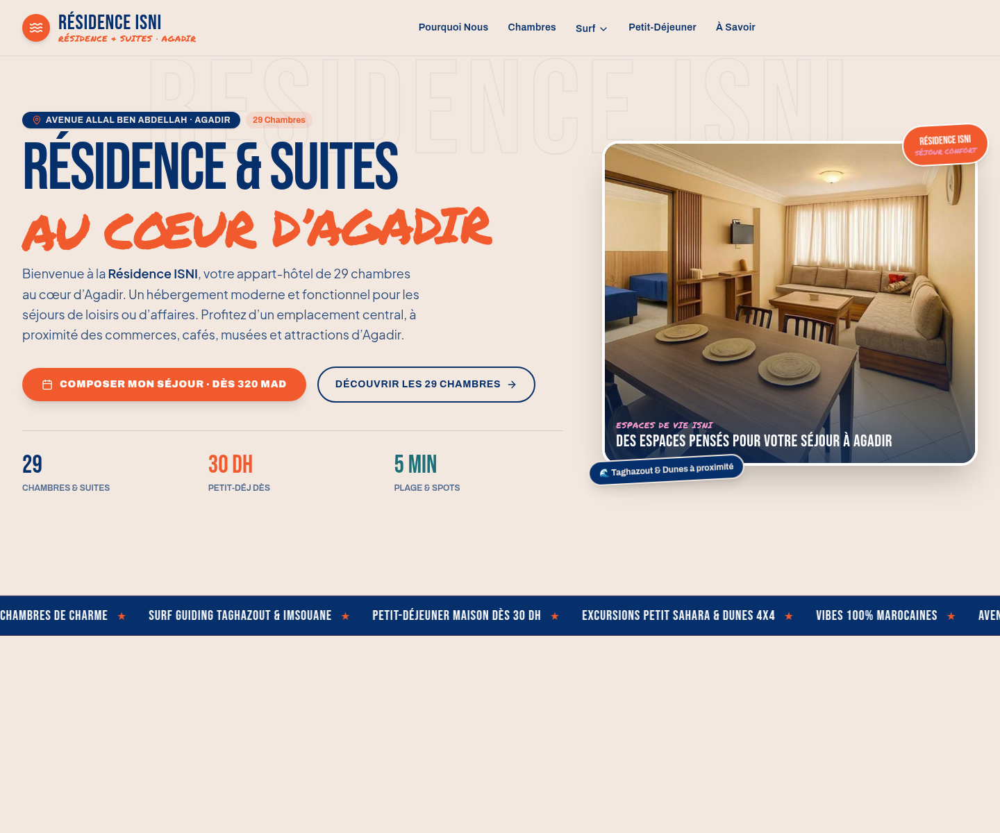

# ISNI Résidence & Suites

Site vitrine et formulaire de demande de séjour pour la Résidence ISNI à Agadir. L’application est construite avec React, TypeScript et Vite. Le dépôt inclut aussi un thème WordPress généré à partir du même bundle que le site local.

## Interface actuelle



La capture montre le site local au 30 octobre 2026. Elle représente la page d’accueil après la disparition de l’écran de chargement.

## Démarrer le site

Prérequis : Node.js et npm.

```bash
npm install
npm run dev
```

Vite affiche l’adresse locale dans le terminal (par défaut `http://localhost:3000`).

## Vérifier et générer le thème WordPress

```bash
npm run lint
npm run build
```

Le build compile l’application et génère `residence-isni-theme.zip`, prêt à être téléversé dans WordPress. Le thème embarque le même bundle React et les mêmes styles que la version locale.

## Réservations et disponibilité

Le formulaire actuel recueille une demande de réservation et peut l’envoyer au backend WordPress / Google Sheets configuré. Il ne consulte pas le stock Booking.com et ne confirme donc pas la disponibilité en temps réel. Pour préparer cette connexion, suivre [le guide d’intégration Booking.com](docs/BOOKING_COM_INTEGRATION.md).

## Contenu du projet

- `src/` : application React, pages, données et formulaire de réservation.
- `public/assets/` : photographies et médias utilisés par le site et le thème.
- `src/utils/wordpressThemeGenerator.ts` : fichiers et structure du thème WordPress.
- `scripts/` : préparation du bundle et génération de l’archive WordPress.
- `residence-isni-theme.zip` : dernière archive WordPress générée.
